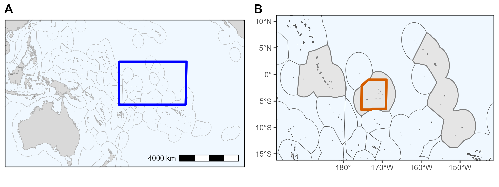
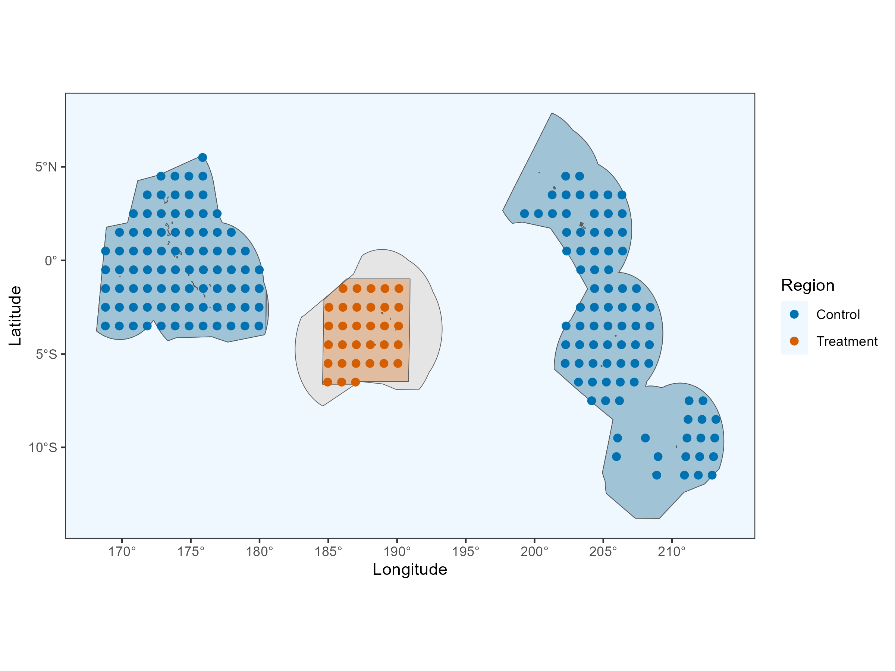

```{r}
# Load packages
library(fixest)
library(modelsummary)
library(tidyverse)
```

**Keywords**: Blue Paradox, Marine Protected Areas, Fishing Behavior, Fisheries Management, Overfishing

# Introduction

A rising question for marine conservation is whether announcing a marine protected area (MPA) can unintentionally increase fishing effort before protection begins. MPAs, like other environmental interventions, are increasingly recognized as tools for biodiversity conservation<!--source?-->. Target 3 of the Convention on Biological Diversity emphasizes that the establishment and management of protected areas should involve fishers and local communities to ensure transparency, participation, and resilient management [@secretariatoftheconventiononbiologicaldiversityTarget3Conserve2022]. However, early disclosure of MPAs can create a tension: informing fishers in advance may encourage preemptive exploitation of resources, potentially undermining conservation objectives. @mcdermottBlueParadoxPreemptive2019 termed this phenomenon the “blue paradox” after documenting a surge in fishing effort hours prior to the implementation of the Phoenix Island Protected Area (PIPA).

One explanation for anticipatory fishing behavior comes from psychological reactance, which suggests that people resist perceived threats to their freedom by attempting to restore it [@brehmTheoryPsychologicalReactance1966]. The restriction-sensitive choice model builds on this idea by formalizing how removing or restricting options can paradoxically make them more desirable [@boissonnetGrabbingForbiddenFruit2025]. These types of responses have been documented across environmental management. For example, when landowners in North Carolina learned that the red-cockaded woodpecker might be listed as endangered, some rushed to modify their properties, removing or destroying habitats that would soon become protected in order to avoid future restrictions under the Endangered Species Act. This preemptive behavior ultimately reduced the very critical habitat that the listing of the species intended to protect, illustrating how anticipated regulations can trigger counterproductive or defensive actions [@lueckPreemptiveHabitatDestruction2000]. An alternative explanation can be found in fisheries management, where closure announcements can also inadvertently reveal information about the productivity of nearby fishing grounds. In Peru's anchoveta fishery, regulators temporarily closed areas with high amounts of juvenile fish to reduce catch. However, these announcements also signaled to fishers that areas near the closures were productive, reducing search costs and prompting them to increase fishing effort outside the closure boundary. This information spillover ultimately counteracted the policy's intended effect to protect the over harvest of juvenile fish [@englanderInformationSpilloversTargeting2023]. These examples suggest that conservation policies can unintentionally alter behavior before restrictions take effect, providing a theoretical framework for interpreting the blue paradox. Understanding how these competing goals interact is critical for the effective design and implementation of MPAs.

Given this tension, it is critical to consider how MPA implementation impacts fishing grounds. @mcdermottBlueParadoxPreemptive2019 reported that the announcement of the future no-take MPA, PIPA (@fig-aoi), triggered a surge in fishing effort within the area slated for protection prior to establishment. The recorded fishing effort was measured as equivalent to 1.5 years of banned fishing: a 130% increase. However, two competing explanations have been proposed for the observed increase in fishing effort. @mcdermottBlueParadoxPreemptive2019 interpreted the increased fishing effort as an anticipatory behavioral response to the announced closure (blue paradox). Under this hypothesis, fishing effort would increase without a corresponding increase in fish abundance, resulting in a declining catch per unit effort (CPUE). In contrast, @hanichUnravelingBlueParadox2018 argued that favorable environmental conditions, particularly El Niño, increased tuna abundance and attracted greater fishing activity in the soon-to-be closed area during the period of this study. Under this explanation, CPUE would be expected to increase across the region because more fish were available and not as a result of anticipatory behavior.

{#fig-aoi}

<!--Need to adjust panel A square, edit colors-->

The existing evaluation of the blue paradox relies primarily on fishing effort. It is important to consider, however, that fishing effort alone cannot distinguish whether increased activity reflects a behavioral response by fishers or changing ecological conditions. In order to reevaluate the blue paradox, this study makes three contributions. First, we assess whether the patterns previously reported for PIPA can be reproduced using Regional Fisheries Management Organization (RFMO) data. We also expand the PIPA case study to other large scale MPAs in order to evaluate whether the blue paradox is a recurring event in Galápagos Marine Reserve (GMR), Revillagigedo National Park (RNP), and Palau National Marine Sanctuary (PNMS). Second, we extend the previous analysis by incorporating total catch to calculate CPUE, allowing us to distinguish changes in fishing activity from changes in fishing success and fish availability. Third, because our approach does not utilize Global Fishing Watch's AIS-derived fishing effort data, which begins in 2012 [@kroodsmaTrackingGlobalFootprint2018a], we demonstrate whether RFMO data capture similar patterns to those observed in AIS records, thereby expanding the temporal range of potential analyses using RFMO data.

# Methods

## Catch and effort data preparation

This study uses publicly available data from Regional Fisheries Management Organizations (RFMOs) to evaluate evidence of the Blue Paradox in the Phoenix Island Protected Area. The primary sources are the Inter-American Tropical Tuna Commission (IATTC) and the Western and Central Pacific Fisheries Commission (WCPFC). Both RFMOs provide monthly catch and effort data at a 1$^\circ$ x 1$^\circ$ spatial resolution.

The data from each RFMO was harmonized into a singular dataset used for this study [@emilyrodriguezRFMOTunaCatch2026]. For each grid cell and month, the variables in @tbl-variables were calculated across both RFMOs. Catch, effort, and CPUE were set to NA when their value was zero.

<!--should the tuna names be their species name in the table?-->

| Variable | Description |
|-----------------------|-------------------------------------------------|
| Effort (days) | Number of fishing days |
| Effort (sets) | Number of fishing sets |
| Total catch (mt) | Metric tons of all selected species (albacore, big eye, skipjack, and yellowfin tuna) |
| CPUE (days) | Total catch (mt) divided by fishing days |
| CPUE (sets) | Total catch (mt) divided by fishing sets |

: Defined variables in the harmonized RFMO data set [@emilyrodriguezRFMOTunaCatch2026]. {#tbl-variables)}

## Spatial processing

### PIPA Data

Because RFMO data are reported at the grid-cell level (1$^\circ$ x 1$^\circ$), each observation was converted into a polygon representing the corresponding spatial cell. For each record, a square polygon was generated by offsetting the reported longitude and latitude by $\pm$ 0.5. Spatial boundaries were then used to to classify cells into the following categories: treatment (cells that are inside or intersect with the border of PIPA) and control (cells that are inside or intersect with the border of either the Line Islands Exclusive Economic Zone (EEZ) or the Gilbert Islands EEZ). Cells that intersected the border of PIPA, even if they overlapped into the un-closed surrounding EEZ of the Phoenix Islands, were kept to ensure substantial data were available, as excluding these cells did not provide enough data for the analysis. All other cells that did not fall within these two categories were discarded.

The total area of PIPA, Line Islands EEZ, and Gilbert Islands EEZ were calculated by projecting the boundaries in EPSG:6933 and computing polygon area in km$^2$.

### Additional case studies

Different rules for spatial clipping were set on a case by case basis. For GMR, cells that were within or intersected with the GMR border were kept, except those whose centroid did not fall within the GMR. This rule was changed for GMR in order to ensure substantial data was available, but noise from the legal fishing areas did not contribute<!--supplementary figure here?-->. The control region was established as the mainland EEZ of Ecuador. All cells that fell within the EEZ or intersected were kept.

For RNP, all cells within the RNP region and whose centroid fell within the RNP were kept as the treatment region. Cells that were on the border of the treatment region but whose centroid did not fall within RNP were removed from the analysis and not considered for the control region<!--supplementary figure here?-->. The control region for RNP was established as cells within 200 nautical miles of the MPA and within Mexico's EEZ. All intersecting cells within this region were kept.

The PNMS treatment region was defined as all cells within or intersected the original 2015 boundary of the MPA [@jaitehBycatchEstimatesPacific2021]<!--update as needed for this analysis-->. The control region was established as cells within 200 nautical miles of the Palau EEZ, but located within or intersecting with the Federated States of Micronesia (FSM). This was selected due to the limited control region availability within the Palau EEZ, as well as a lack of data within this area<!--should cite here why this choice/supplementary figure-->. However, because of the limited overall data available, a true blue paradox analysis for PNMS was not possible<!--should this be kept here or moved to the results?-->.

All control and treatment region areas were calculated by projecting the boundaries in EPSG:6933 and computing polygon area in km$^2$.

## Temporal boundaries

### PIPA Data
<!--thinking to reformat this section for how we define the dates so its more concise and clear, not sure best method right now-->
The original announcement and implementation dates of PIPA selected by @mcdermottBlueParadoxPreemptive2019 were used for this analysis (@tbl-dates). Fishing behavior was analyzed one year prior to the announcement.

| Date       | Description                                            |
|:-----------|:-------------------------------------------------------|
| 2012-09-01 | One year before the 2013 MPA announcement              |
| 2013-09-01 | Online announcement date, as defined by the PIPA paper |
| 2015-01-01 | Policy implementation date                             |
| 2016-01-01 | One year after implementation                          |

: Study dates for the PIPA blue paradox analysis defined by @mcdermottBlueParadoxPreemptive2019. {#tbl-dates}

### Additional case studies

For the GMR analysis, the temporal were defined differently compared to other case studies<!--should better defend this choice-->. The announcement date was instead defined as the day GMR was signed into law (1998), while the implementation date was defined as the date enforcement was added to the MPA region (2002) [@boerderInteractionsTunaFisheries2017a]<!--these papers do not give us the month date-->.

The announcement date for RNP was defined as October 5, 2017 [@naturalesEsquemaParqueNacional] while the date of implementation was defined as November 27, 2017 [@martinezGlobalMarineProtected2025]. Because of the limited temporal gap between announcement and implementation, a full analysis to test for the blue paradox was not possible with the data used for this paper<!--should this be in the results with figures-->.

The announcement date for PNMS was cited on October 22, 2015, where it was announced that PNMS would be established over a five-year period, leaving a small area of Palau open to domestic fishing [@PalauSignNational; @martinezGlobalMarineProtected2025]<!--not sure if this extra description goes here-->. The implementation date was defined as January 1, 2020 [@martinezGlobalMarineProtected2025].

## Pixel-level Model creation

To estimate preemptive fishing behavior, the analysis uses a before-after-control-impact (BACI) design. The unit of observation is the grid cell-month. The panel dataset includes all treatment and control cells, all months before implementation, a treatment indicator (equal to 1 for cells within for PIPA), and a post-announcement indicator (equal to 1 during the anticipation period). The baseline regression model is:

$$\text{log}(Y_{it}) = \beta_0 + \beta_1\text{Treatment}_i + \beta_2\text{Post}_t + \beta_3(\text{Treatment}_i \times \text{Post}_t) + \epsilon_{it}$$

where:

- $Y_{it}$ is the outcome (catch, effort, or CPUE) in grid cell $i$ during month $t$.
- $\beta_0$ is the intercept, representing the log outcome for control grid cells before the announcement.
- $\text{Treatment}_i$ is an indicator equal to 1 for grid cells within the future MPA and 0 for control grid cells.
- $\beta_1$ measures the baseline difference in the log outcome between treatment and control grid cells before the announcement.
- $\text{Post}_t$ is an indicator equal to 1 for months during the anticipation period and 0 for months before the announcement.
- $\beta_2$ measures the change in the log outcome over time for control grid cells.
- $\text{Treatment}_i \times \text{Post}_t$ is the interaction term.
- $\beta_3$ is the BACI (difference-in-differences) estimator, measuring the additional change in the log outcome for treatment grid cells during the anticipation period relative to the change observed in control grid cells (blue paradox effect).
- $\epsilon_{it}$ is the error term.

The model was repeated for the following variables: effort (days), effort (sets), total catch (mt), CPUE (sets), and CPUE (days). Models were estimated using Conley standard errors to account for spatial correlation. For the GMR and RNP analysis, effort and CPUE in days were not available.

## Region-level model creation

The models were repeated using data aggregated the region-by-month level. For each region and month, total catch, total effort (days and sets) were calculated by summing observations across all fishing events. Catch was converted from metric tons to kilograms to improve model variable interpretation. CPUE was then calculated as the ratio of total catch to total fishing effort, rather than aggregating observation-level CPUE values. To account for differences in region size, total catch and total fishing effort were standardized by region area and expressed per 10,000 km$^2$. In this model, $Y_{jt}$ is the region-level outcome (catch per 10,000 km$^2$, effort per 10,000 km$^2$, or CPUE in region $r$ on date $t$). For the GMR and RNP analysis, effort and CPUE in days were not available.

## Processing

All processing and analyses were conducted in R [@zotero-item-713]. Spatial data for MPAs and related EEZs were obtained from the mregions2 package [@guevaraMregions2AccessData2022]. Spatial data for the updated 2019 Palau EEZ and PNMS were obtained from<!--maybe cite repo https://github.com/emlab-ucsb/vds-mpa-paper/tree/master  here? Also, I think something came from mregions2 or another source, not sure-->. Related maps were built using ggplot2 [@ggplot2] and sf [@pebesmaSimpleFeaturesStandardized2018a]. Models were fit using the fixest package [@bergeFixestFastFeaturerich2026]<!--terra? rnaturalearth?-->. Model tables were built using the modelsummary package [@modelsummary] and time series were created using ggplot2 [@ggplot2]<!--or just cite tidyverse?-->. Coefficients from the log-linear models were exponentiated in the written results to express effects as percentage changes. Percentage change was calculated as $(e^{\beta}-1) \times 100$, where $\beta$ represents the estimated regression coefficient. This provides the exact percentage change associated with a one-unit change in the predictor.

# Results

## PIPA

Cumulative fishing effort in days five years prior to announcement demonstrates varying patterns across the study region (@fig-fishing-effort). The Line Islands EEZ presents lower log-fishing effort within its EEZ. Higher concentrations of fishing effort are clustered around the eastern and southern EEZ of the Gilbert Islands. The Phoenix islands display mixed concentrations of effort.<!--maybe cut this part since now we have the AOI figure?-->

{#fig-fishing-effort}

Log-linear pixel-level BACI models indicated little significant evidence that the announcement of PIPA closure produced changes in fishing behavior during the anticipation period (@tbl-pipa-pixel). Prior to the announcement, treatment cells exhibited significantly lower fishing effort than control cells, averaging approximately -34% lower fishing effort measured in days ($\beta$ = -0.419, SE = 0.157, *p* \< 0.01). Total catch was marginally lower in treatment versus control cells by approximately -28% ($\beta$ = -0.334, SE = 0.188, *p* \< 0.10). Baseline differences in CPUE and effort measured in sets were not statistically significant.

During the anticipation period, control cells demonstrated little change in fishing effort or total catch. There was a significant temporal change by +13% in CPUE measured per fishing day among control cells ($\beta$ = 0.118, SE = 0.055, *p* \< 0.05). All treatment cells showed a percent increase for each model variable relative to the control region in during the anticipation period. The BACI coefficient for total catch in PIPA cells increased by an estimated +36% relative to control region cells ($\beta$ = 0.304, SE = 0.215, *p* \< 0.10). Effort measured in sets had the smallest percent increase in the PIPA cells relative to the control region cells (+5.9%, $\beta$ = 0.058, SE = 0.259, *p* \< 0.10). CPUE measured per fishing day was positive, indicating that CPUE in PIPA cells increased by an estimated +19% relative to the change observed in control region cells ($\beta$ = 0.177, SE = 0.116, *p* \< 0.10). CPUE measured in sets increased by approximately 28% ($\beta$ = 0.245, SE = 0.162, *p* \< 0.68)  (@fig-pipa-pixel). However, none of the BACI interaction terms were statistically significant, providing no evidence that fishing effort, total catch, or CPUE changed significantly between treatment and control cells during the anticipation period.

```{r}
#| label: tbl-pipa-pixel
#| tbl-cap: Log-linear BACI regression estimates at the pixel-month level for PIPA. The interaction term (MPA announcement effect) estimates the percentage change in treated cells relative to control cells during the anticipation period. Conley standard errors are used.

pixel_pipa <- readRDS("../data/output/pipa/m_pixel_log.rds")

pipa_pixel_list <- as.list(pixel_pipa)

names(pipa_pixel_list) <- c(
  "log Effort (days)",
  "log Effort (sets)",
  "log Total Catch (mt)",
  "CPUE (mt/days)",
  "CPUE (mt/sets)"
)


modelsummary(
  pipa_pixel_list,
  stars = TRUE,
  coef_map = c(
    "treatment" = "Pre-announement difference (treatment)",
    "post" = "Post-announcement change (control)",
    "treatment:post" = "MPA announcement effect (treatment)"
  ),
  gof_map = c(
    "nobs",
    "r.squared",
    "adj.r.squared"),
  output = "latex",
  width = 1
)
```

{#fig-pipa-pixel}

Standardizing for area, the region-level log-linear BACI models indicated significant increases in effort (sets and days) and catch in the control region during the announcement period (@tbl-pipa-region). Effort density increased by approximately +277% for fishing days ($\beta$ = 1.328, SE = 0.434, *p* \< 0.01) and +311% for fishing sets ($\beta$ = 1.414, SE = 0.458, *p* \< 0.01), while catch density increased by approximately +302% ($\beta$ = 1.391, SE = 0.448, *p* \< 0.01) in the control region post-announcement (@fig-pipa-region). The interaction terms were positive across effort and catch for the interaction term, suggesting larger increases in the treatment region relative to controls (approximately 40–46%), but these effects were not statistically significant.

```{r}
#| label: tbl-pipa-region
#| tbl-cap: Log-linear BACI regression estimates at the region-level for PIPA. The interaction term (MPA announcement effect) estimates the percentage change in the treatment region relative to control region during the anticipation period.

region_pipa <- readRDS("../data/output/pipa/m_region_log.rds")

pipa_region_list <- as.list(region_pipa)

names(pipa_region_list) <- c(
  "log Effort (days) / km²",
  "log Effort (sets) / km²",
  "log Total Catch (kg) / km²",
  "CPUE (kg/days)",
  "CPUE (kg/sets)"
)

modelsummary(
  pipa_region_list,
  stars = TRUE,
  coef_map = c(
    "treatment" = "Pre-announement difference (treatment)",
    "post" = "Post-announcement change (control)",
    "treatment:post" = "MPA announcement effect (treatment)"
  ),
  gof_map = c(
    "nobs",
    "r.squared",
    "adj.r.squared"),
  width = 1
)
```

{#fig-pipa-region}

## Additional case studies

### GMR

Log-linear pixel-level models for GMR indicated that effort (sets), total catch (mt), and CPUE (mt/sets) were generally higher (approximately 10%-36%) in the treatment region cells relative to the control region cells prior to the announcement of GMR (@tbl-gmr-pixel). After the implementation of GMR, total catch (kg) and CPUE measured in sets significantly increased in the control region area by approximately +47% and +42% ($\beta$ = 0.386, SE = 0.146, *p* \< 0.01; $\beta$ = 0.348, SE = 0.120, *p* \< 0.01)(@fig-gmr-pixel). Effort measured in sets was minimally higher in the control region after implementation of GMR by approximately 3.9% but was not significant (*p* \< 0.1). Within the treatment region, effort (sets) decreased by approximately -1.7% ($\beta$ = -0.017, SE = 0.137, *p* \< 0.1) while catch and CPUE increased by about +15.7% and +17.7%, but none were significant (@tbl-gmr-pixel).

```{r}
#| label: tbl-gmr-pixel
#| tbl-cap: Log-linear BACI regression estimates at the pixel-month level for GMR. The interaction term (MPA announcement effect) estimates the percentage change in treated cells relative to control cells during the anticipation period. Conley standard errors are used.

pixel_gmr <- readRDS("../data/output/gmr/m_pixel_log.rds")

gmr_pixel_list <- as.list(pixel_gmr)

names(gmr_pixel_list) <- c(
  "log Effort (sets)",
  "log Total Catch (mt)",
  "CPUE (mt/sets)"
)

modelsummary(
  gmr_pixel_list ,
  stars = TRUE,
  coef_map = c(
    "treatment" = "Pre-announement difference (treatment)",
    "post" = "Post-announcement change (control)",
    "treatment:post" = "MPA announcement effect (treatment)"
  ),
  gof_map = c(
    "nobs",
    "r.squared",
    "adj.r.squared"),
  output = "latex",
  width = 1
)
```

<!--need to fix height of figures below-->

{#fig-gmr-pixel}

The log-linear region-level model indicated effort measured in sets was significantly lower in the treatment region relative to the control by approximately -66.4% prior to the implementation of GMR ($\beta$ = -1.092, SE = .524, *p* \< 0.05). Total catch was also lower, but not significantly ($\beta$ = -0.848, SE = .590, *p* \< 0.1) (@tbl-gmr-region).

After the implementation of GMR, effort and catch within the treatment region decreased by -41% and -38.2% ($\beta$ = -0.528, SE = .605, *p* \< 0.1; $\beta$ = -0.482, SE = .681, *p* \< 0.1), greater than the marginal decrease captured in the pixel-level model (@tbl-gmr-region). CPUE increased marginally by 4.7%, but none of the modeled changes were significant.

```{r}
#| label: tbl-gmr-region
#| tbl-cap: Log-linear BACI regression estimates at the region-level for GMR. The interaction term (MPA announcement effect) estimates the percentage change in the treatment region relative to the control region during the anticipation period.

region_gmr <- readRDS("../data/output/gmr/m_region_log.rds")

gmr_region_list <- as.list(region_gmr)

names(gmr_region_list) <- c(
  "log Effort (sets) / km²",
  "log Total Catch (kg) / km²",
  "CPUE (kg/sets)"
)

modelsummary(
  gmr_region_list,
  stars = TRUE,
  coef_map = c(
    "treatment" = "Pre-announement difference (treatment)",
    "post" = "Post-announcement change (control)",
    "treatment:post" = "MPA announcement effect (treatment)"
  ),
  gof_map = c(
    "nobs",
    "r.squared",
    "adj.r.squared"),
  output = "latex",
  width = 1
)

```

<!--this figure below for CPUE seems strange, need to check code-->

{#fig-gmr-region}

### RNP

### PNMS

<!--how do we discuss these in the results?-->

# Discussion

<!--line about the blue paradox as anticipatory vs. ecological drivers, why CPUE is essential, why RFMO data offers new lens-->

## PIPA

This study reassesses the prior analysis of the blue paradox effect on PIPA. Previous work by @mcdermottBlueParadoxPreemptive2019 found that fishing effort increased 130% in response to the announcement of PIPA. We find non-significant increases in fishing catch and effort within PIPA from the announcement date leading up to the implementation of the MPA.

Prior to the announcement of PIPA, the pixel-level model indicates that catch, effort, and CPUE were generally lower within the treatment region compared to the control. All five model variables increased during the announcement period within PIPA. Effort measured in days only increased by about 7.8%, while CPUE measured in mt/days increased by almost 20%. Comparably, effort in sets only increased by about 6%, while CPUE measured in mt/sets increased by about 28%<!--should i be restating these percentages as a reminder or is it redundant--> (@tbl-pipa-pixel). This model suggests that fishing did not increase in response to the announcement of PIPA, but rather because of favorable fishing conditions yielding higher profitability, consistent with the competing hypothesis by @hanichUnravelingBlueParadox2018.<!--source here about conditions this year-->

However, the PIPA region-level model suggests a different explanation. Though not significant, catch, effort (days), and effort (sets) are noticeably greater in the treatment region compared to the control during the anticipation period (@fig-pipa-region). However, CPUE in kg/days only modestly increased by approximately by 4.8%, while effort in days/km$^2$ increased by almost 40%. These contrasting results suggest that the response during the announcement period was not uniform within PIPA. Aggregation to the region level overall captures a broader redistribution of fishing effort. Directionally, these results are more consistent with arguments made by @mcdermottBlueParadoxPreemptive2019 on anticipatory behavioral responses rather than an increase in fish availability. However, the results are not statistically conclusive. This model does not demonstrate a decline in CPUE that would be expected under a blue paradox mechanism, but neither does it provide substantial evidence of an increase in catch efficiency that would be expected if increased tuna abundance were the primary drivers.<!--maybe need to discuss more here-->

## Additional Case Studies

GMR showed little evidence of the blue paradox. Prior to the implementation of GMR, effort, catch, and CPUE were already higher within the treatment region relative to the control per the pixel-level model. This indicates that the treatment region already attracted higher levels of fishing without the implication of an MPA implementation. After the implementation of GMR, the only significant changes occurred outside the soon-to-be closed region. Total catch and CPUE increased substantially (+47% and +42%). Effort only increased slightly and was not significant. This could indicate a redistribution of effort towards more productive cells<!--source?-->. The treatment region had little response to the implementation of GMR. Effort declined slightly by -1.7%, while catch and CPUE had modest increases (+15.7% and +17.7%), but none were significant. The lack of strong trends suggest that the implementation of GMR had little effect on the decisions of fishers. The region-level model reveals larger decreases within GMR after implementation. Effort specifically decreased by -41%, while catch decreased -38.2%, the opposite of a blue paradox effect.

Revillagigedo was implemented a little over a month after its announcement, which would likely not allow for a blue paradox to occur. Even if it were to occur, the data we use does not allow a test for it. <!--not sure if data should be included in the results or as supplementary material-->

Palau had little to no data available. <!--for Palau, should address changing locations of PNMS)-->

## RFMO Data Expansion

Notably, the PIPA region-level model successfully reproduces the trend in fishing effort related to the announcement of PIPA as modeled by @mcdermottBlueParadoxPreemptive2019, indicating that RFMO data can yield similar ecological results. This trend is most distinct within @fig-pipa-region, specifically in panel A, which indicates a greater increase in effort in the treatment region relative to the control, similar to the previous findings by @mcdermottBlueParadoxPreemptive2019.<!--should we put mcdermott figure here maybe? or ref it some how?-->

## Conclusion

The collective results across PIPA and GMR suggest that the blue paradox is not a universal response to MPA announcements. Anticipatory behavior is contingent on a specific set of conditions, including sufficient time between announcement and closure, clear expectations of future access loss, and stable ecological conditions<!--basically want to address here the conflicting, but non significant, results of PIPA-->. In the case of PIPA, pixel-level models indicate that profitability was the main driver for movement of vessels in the soon-to-be closed region, while the region model shows both catch and effort rising, yet little change to CPUE. The overall results are more consistent with the trends reported by @mcdermottBlueParadoxPreemptive2019, but neither provide significant evidence on the expected changes in CPUE for the @mcdermottBlueParadoxPreemptive2019 or @hanichUnravelingBlueParadox2018 hypotheses. Across the additional case studies, we find little evidence of the blue paradox acting as a repeated pattern in other large-scale MPAs. GMR exhibited stable or declining effort, while RNP's short announcement window allowed little time for a blue paradox to occur. PNMS lacked sufficient data for inference, but the data that were available showed little changing trends in fishing effort between the control and treatment <!--ref figure here-->. Importantly, this study demonstrates that RFMO data can be used to reproduce broad patterns captured in AIS data provided by @kroodsmaTrackingGlobalFootprint2018a. This expands analysis possibilities on a historical scale. 

Taken together, these  results suggest that anticipatory responses to MPAs is highly context-dependent, shaped by ecological conditions, announcement timing, and fleet behavior rather than by MPA designation alone. Rather than signaling a universal blue paradox, the results indicate a context-dependent response for each MPA analyzed. Overall, this work highlights the need to interpret blue paradox dynamics through the use of both catch and effort.
<!--Need good closing statements-->

# References
