<!--need to fix-->
## Do marine protected area announcements trigger preemptive overfishing? New insights from tuna catch and effort data {.title-slide}

**Emily Rodriguez**

University of Miami
Rosenstiel School of Marine, Atmospheric, and Earth Science


**Project Committee**

Dr. Juan Carlos Villaseñor-Derbez, Chair and Internship Supervisor
<br>
Gavin McDonald, Member  
Dr. Manoj Shivlani, Member


```{r include=FALSE}

pacman::p_load(
  tidyverse,
  sf,
  mapview,
  lwgeom,
  viridis,
  terra,
  ggspatial,
  rnaturalearth,
  rnaturalearthdata,
  patchwork,
  mregions2
)
```


## A call for expanded protection

- **30x30 Target** [@secretariatoftheconventiononbiologicaldiversityTarget3Conserve2022]

  - Protect and effectively manage 30% of marine areas by 2030 via marine protected areas (MPAs).
  - Conservation efforts should be equitably governed where affected stakeholders included in decision making.
    - **Procedural Equity**
    - **Representative Equity**

::: fragment
### Key Question: 

> **How might fishers react when they learn they are going to lose access to established fishing grounds?**

:::

::: {.notes}

- There's an increasing global push to expand marine protection.
- Under the Convention on Biological Diversity, the 30x30 target calls for
- protecting and effectively managing 30% of the world's marine and coastal areas by 2030, via marine protected areas. However, achieving this target is not just about protecting marine ecosystems;
- it is also about ensuring that conservation efforts are equitably governed. This brings in two important dimensions of equity which are
    - procedural equity, and that is ensuring that affected stakeholders, like fishers in this case, have access to information about upcoming management decisions.
    - and representative equity, ensuring these groups have meaningful presence in public feedback, participation, and decision making
    - (don’t skip) And this creates an interesting tension. Involving stakeholders in management decisions is important for equitable governance, but it also means fishers, for example, may learn about upcoming restrictions and closures in advance.
- Which brings us to the question: How might fishers react when they learn they are going to lose access to established fishing grounds?

:::


## Two paradoxes

::::: columns
::: {.column width="50%"}

:::fragment
##### The Green Paradox

> **Example:** Private forest owners in North Carolina preemptively destroyed an endangered species’ habitat to avoid future restrictions on their property [@lueckPreemptiveHabitatDestruction2000].
:::

:::
::: {.column width="50%"}

::: fragment
##### **The Blue Paradox**

> The announcement of a future no take MPA in Kiribati caused an increase in fishing effort in the area slated for protection leading up the the MPA's implementation [@mcdermottBlueParadoxPreemptive2019].
:::

:::
:::::

::: fragment
**Key differences:**

- Only one documented case of a blue paradox.

- You don't "own" a plot of ocean in the same way you own a plot of land.

- The blue paradox has implications for equitable establishments of MPAs.
:::

::: {.notes}
- This takes us to two paradoxes
- The first is the **green paradox: the idea that  when resource owners expect future environmental restrictions, they may actually speed up extraction to avoid those restrictions..**
    - We see similar behavior in other environmental contexts. For example, in North Carolina, landowners have preemptively destroyed habitat used by an endangered woodpeckers to avoid future land-use restrictions.
- But what about a similar paradox in the marine environment?
    - So far, there's only one documented case of what's been termed the **blue paradox**. Researchers found that the announcement of a future no-take MPA in Kiribati led to increased fishing effort within the area before protections came into place
- However, there are some important differences between these two paradoxes.
    - First, we only have one documented case of a blue paradox, providing little evidence and making it difficult to know how widespread this behavior might be.
    - Second, the ownership structure is very different. Unlike land, the ocean is largely a shared resource, which creates different incentives. For example, fishers may want to maximize their catch before losing access to productive fishing grounds, or make use of fishing days they've already purchased for the region.
    - Third, the blue paradox raises a difficult question about equitable management. While we want fishers to be included in the decision-making process, could providing advance knowledge of closures unintentionally encourage increased fishing effort and undermine conservation goals?
:::

## Competing explanations


::: fragment
> @mcdermottBlueParadoxPreemptive2019 found a 130% increase in fishing *effort* following the announcement of the Phoenix Islands Protected Area (PIPA).
:::

::::: columns
::: {.column width="50%"}

- Two explanations $\rightarrow$ both agree on the effort increase
- Neither agree *why*
- Preemptive behavior vs. environmental factors?

:::fragment
::: {style="background-color: #f0f0f0; border-radius: 5px; padding: 15px;"}
Catch per unit effort (CPUE)
:::
:::


:::
::: {.column width="50%"}

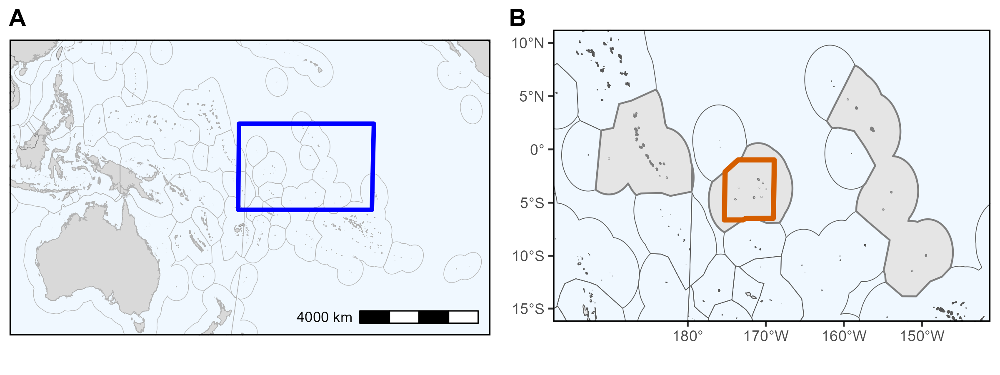

:::
:::::

::: {.notes}
- **But before we can address this management challenge, we first need to understand what actually drove the increase in fishing effort observed in Kiribati.**
- This brings us back to the original finding of the blue paradox. Researchers recorded a 130% increase in fishing *effort* following the announcement of the future no-take MPA Phoenix Islands Protected Area (PIPA), highlighted in red in panel b. This measure of effort specifically came from vessel tracking data, looking at daily fishing hours.
- However, there are two competing explanations for this occurrence. Both agree that effort increased,
- but neither agree as to *why*.
- So Was the increased effort a response to the upcoming closure, or were there changes in environmental conditions that attracted more fish and therefore, fishing activity? To distinguish between these explanations, we need to look beyond fishing effort
- and consider catch per unit effort, or CPUE, an imperfect proxy for fish abundance.

:::


## The CPUE hypothesis

> @mcdermottBlueParadoxPreemptive2019 found a 130% increase in fishing *effort* following the announcement of the Phoenix Islands Protected Area (PIPA).

::::: columns
::: {.column width="50%"}

::: fragment
**The blue paradox explanation:**

- Fishers rushed into the soon-to-be MPA before closure.
- Effort $\uparrow$ over the same amount of fish.
- **Therefore:** CPUE *should* remain stable or even $\downarrow$ over time
:::

:::
::: {.column width="50%"}

::: fragment
**The environmental explanation:**

- Fishers increased effort because of favorable environmental conditions created by the El Niño Southern Oscillation.
- Effort $\uparrow$ while stock $\uparrow$.
- **Therefore:** CPUE *should* $\uparrow$
:::

:::
:::::


::: fragment
> #### CPUE data was not used for the original analysis
:::

::: {.notes}
- So let’s look at what the two explanations are
- The **blue paradox explanation** suggests that
- fishers rushed into the soon-to-be closed MPA before its closure because of the announcement
    - In this case, fishing effort increases over the same amount of fish present within the MPA
    - Therefore, assuming catchability remains the same, CPUE should remain constant, or even decrease given enough time for stock depletion.
- The competing explanation suggests, however, that **environmental changes** are responsible for this increase in fishing effort
    - In this case, fishers increased effort in the MPA because conditions created by the El Nino Southern Oscillation concentrated tuna into the region.
    - Fishers, following the stock, would be increasing effort over an increasing stock size.
    - Assuming that catchability remains the same, CPUE should *increase* in this scenario
- **The important distinction is that both hypotheses offer different predictions for CPUE, but the original study only examined fishing effort using vessel tracking data, so neither are able to show a change to CPUE.**

:::


## Assessing the competing hypotheses

- **Data:** Use publicly available regional fisheries management organization (RFMO) data compared to vessel tracking data.
- **Analysis:** Incorporate tuna purse seine effort *and* catch data available from RFMOs to calculate **CPUE**.
- **Research questions:**
  1. Can RFMO data reproduce the effort patterns reported by @mcdermottBlueParadoxPreemptive2019?
  2. If so, which hypothesis does the addition of CPUE support?
  
  
  <!-- **Blue paradox:** CPUE ~-->
  <!--- **Environmental effect:** CPUE $\uparrow$-->

:::{.notes}
- My research project seeks to address these differing explanations by incorporating catch per unit effort into the analysis
- This was made possible by my internship work, which included harmonizing publicly available Regional Fisheries Management tuna purse seine data into one complete data set
- This RFMO data specifically includes both catch and effort, which we can use to calculate CPUE.
- With this data, we can answer two questions
    - **First, can RFMO data reproduce the effort patterns reported in the original blue paradox study?**
    - **And if so, which hypothesis does the addition of CPUE support?**

:::


## Separating announcement effects from environmental change

<!--It shows the total number of monthly records per 1° pixel since 1958-2024-->

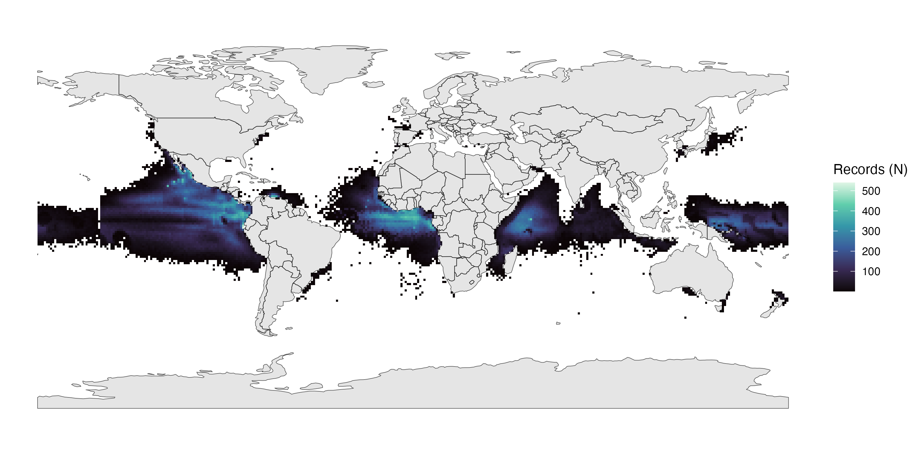

:::{.notes}

- To begin, we first needed to create a harmonized dataset of tuna catch and effort data from Regional Fisheries Management Organizations, or RFMOs.
- This map gives you a sense of the scale of that dataset. It shows the total number of monthly observations recorded in each 1-degree grid cell, spanning from 1958 to 2024.
- These observations include both fishing effort, measured in fishing days and sets, and catch, measured in metric tons.
- We used these catch and effort measures to calculate catch per unit effort, which serves as our key environmental indicator for the blue paradox, allowing us to distinguish between increases in fishing effort and changes in the underlying productivity of fishing grounds.

:::
## Separating announcement effects from environmental change

::::: {.columns}

::: {.column width="50%"}
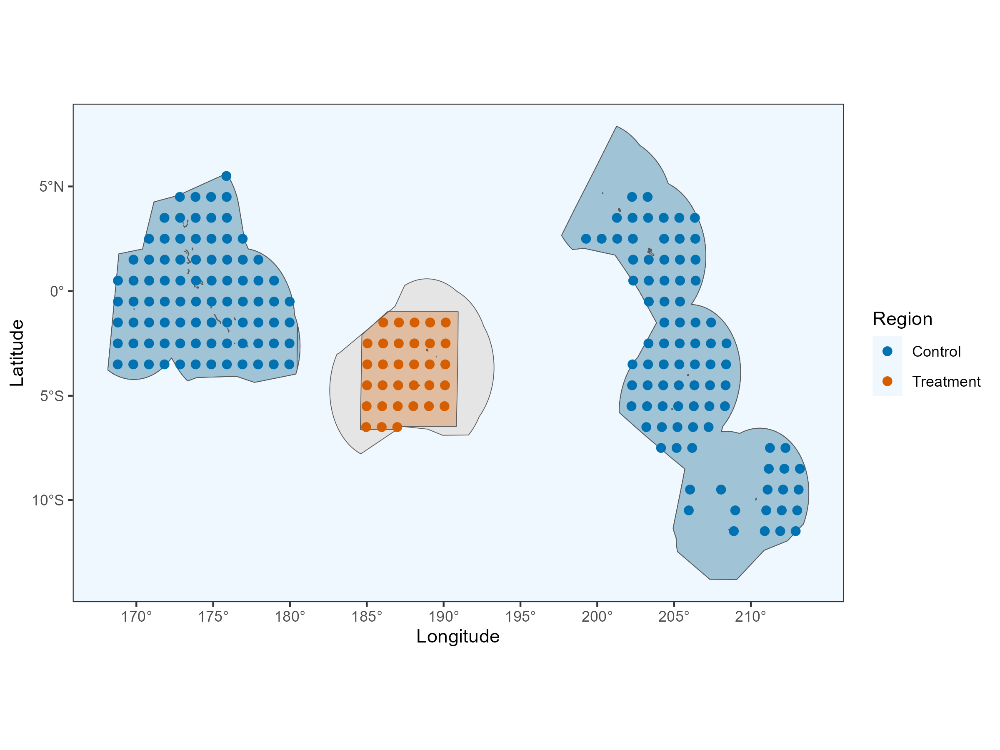
:::

:::{.column width="50%"}

- **Impact: PIPA:** Area within or intersecting the MPA boundary
- **Control: Line + Gilbert Islands:** Comparable areas outside PIPA
  - Aggregate data by region and month
  - Standardize by area

:::

:::::

:::{.notes}
- Next, to assess whether changes in the Phoenix Islands were caused the MPA announcement, rather than reflecting broader environmental shifts, we need a comparable control region.
- Importantly, this region should experience similar fishing conditions, including environmental and regulatory contexts.
- In order to accomplish that, we follow the original *Blue Paradox* study, use the Line and Gilbert Islands Exclusive Economic Zones of Kiribati as our control regions.
- For each group, We aggregated cell data by region and month,
- then standardized  our measures by area to account for differences in spatial coverage of each region.
- And This map on here represents the final data. The orange dots on the map represent our 1 degree cell center observation points in the MPA, and the blue dots represent the observation points in the control  regions
:::

## Separating announcement effects from environmental change

::::: {.columns}

::: {.column width="50%"}

- **Analyze:** Fishing activity changes in both regions
- **Temporal range:** 1 year before MPA announcement $\rightarrow$ MPA establishment
- **Question:** How changes in the treated region compare to the control
  - **Difference-in-differences model**
  - **Key estimate: $\beta_3$** (our estimate of the blue paradox in PIPA)

:::

::: {.column width="50%"}


::: {style="max-width:440px; width:100%; margin:10px auto; font-family:sans-serif;"}

<div style="display:grid; grid-template-columns:1fr 1fr; gap:8px;">

<div style="background:#fbf0e5; border-radius:10px; padding:9px; text-align:center;">
<div style="color:#D9842E; font-weight:600; font-size:0.85em;">Treatment (PIPA)</div>
<div style="font-size:1.6em; font-weight:700; color:#D9842E; margin:3px 0;">+30%</div>
<div style="font-size:0.7em; color:#666;">Illustrative change</div>
</div>

<div style="background:#eaf2f9; border-radius:10px; padding:9px; text-align:center;">
<div style="color:#3986C8; font-weight:600; font-size:0.85em;">Control region</div>
<div style="font-size:1.6em; font-weight:700; color:#3986C8; margin:3px 0;">+10%</div>
<div style="font-size:0.7em; color:#666;">Illustrative change</div>
</div>

</div>

<div style="text-align:center; margin:3px 0; color:#777; font-size:1.1em;">↓</div>

<div style="text-align:center; color:#666; font-size:0.8em; margin-bottom:4px;">
Compare the two changes
</div>

<div style="background:#f2f2f2; border-radius:10px; padding:9px; text-align:center;">
<div style="font-size:1.45em; font-weight:700; color:#333;">+20 percentage points</div>
<div style="font-weight:600; font-size:0.8em; margin-top:2px;">Additional change in PIPA</div>
</div>

<div style="text-align:center; color:#888; font-size:0.6em; margin-top:4px;">
Hypothetical values for illustration only
</div>

:::


<!--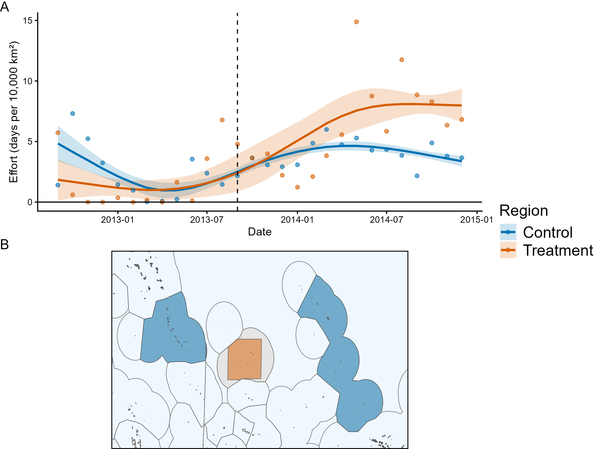-->

::: 

:::::

:::{.notes}

- With our treatment and control regions established, we examine how fishing activity changes over time in both regions.
- To do this we specifically use monthly data, beginning one year before the MPA announcement and continuing through to its implementation.
- **Importantly, we're not just interested in how fishing activity changes within the MPA. We're interested in how that change compares to the control region over the same period.**
- To illustrate this, if you look at the diagram on the right, imagine fishing activity increased by 30% in the MPA, compared to just 10% in the control region.
- Although fishing activity increased in both regions, the increase in the MPA was 20 percentage points greater than in the control. **This additional change is what we're trying to capture.**
- We use a difference-in-differences approach to estimate this additional change, which is represented by our key coefficient.
- In our study, this coefficient captures the additional change in fishing activity in the MPA relative to the control region, and serves as our estimate of the Blue Paradox effect.

:::


## Can RFMO data reproduce documented effort spikes?

::: {.columns}


::: {.column width="50%"}
::: fragment
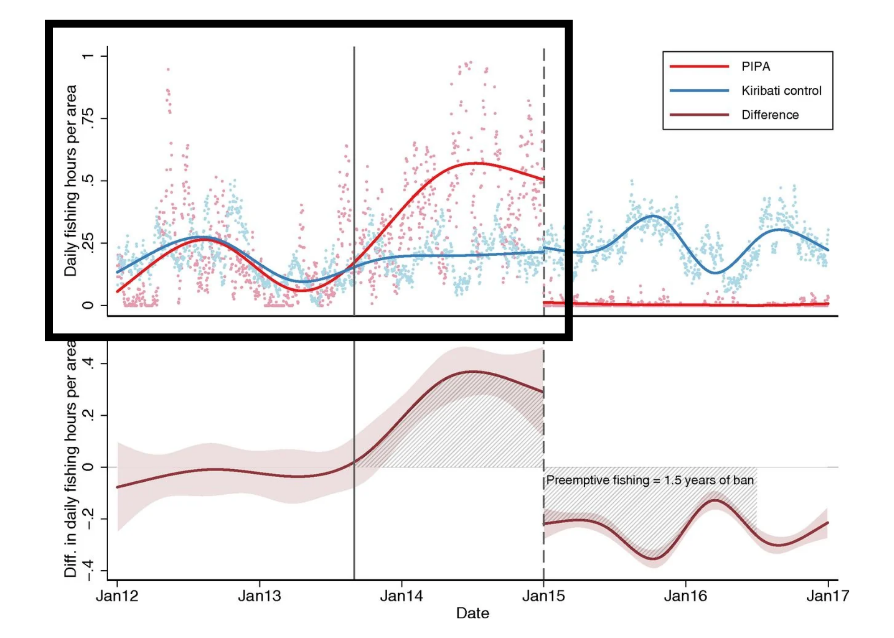{width="100%"}
:::
:::


::: {.column width="50%"}
::: fragment
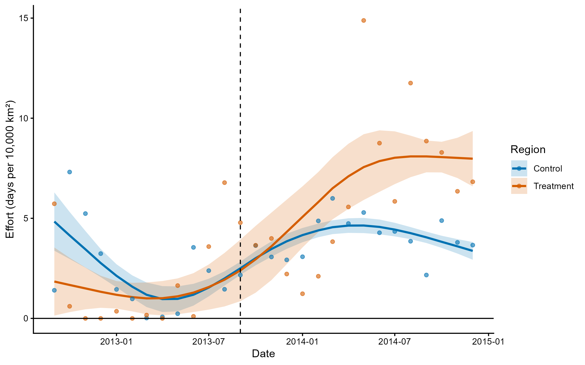{width="100%"}
:::
:::


:::


:::{.notes}
- Returning to our research questions, the first thing we wanted to establish was whether our RFMO data could reproduce the increase in fishing effort inside the MPA that was originally captured using vessel monitoring data.
- To do this, we compare the original time series data with the one constructed using our RFMO data.
- **Starting on the left**, we have the original study's time series of daily fishing activity inside the MPA highlighted inside the box. The x-axis shows the date, while the y-axis shows daily fishing hours. The red line represents fishing activity inside the Phoenix Islands, and the first vertical marker indicates the announcement of the MPA. The closure of the MPA is denoted by the second vertical marker.
- **On the right**, we have our corresponding time series constructed using RFMO data. Again, the x-axis represents the date, while the y-axis shows daily fishing effort. The orange line represents fishing activity inside PIPA, and the vertical dotted line marks the announcement of the MPA.
- Looking at the two figures side by side, we see a similar pattern in fishing activity within PIPA, with effort increasing around the period leading up to implementation.
- This suggests that our RFMO data are able to capture the same general increase in fishing effort documented in the original study.
- However, unlike the original analysis, our results do not show statistically significant changes in daily effort in the treatment region
- This highlights an important limitation. RFMO data may capture broad shifts in fishing activity but may not be sensitive enough to detect fine-scale changes.
:::

## What does the addition of CPUE reveal?

::: {.columns}


::: {.column width="70%"}
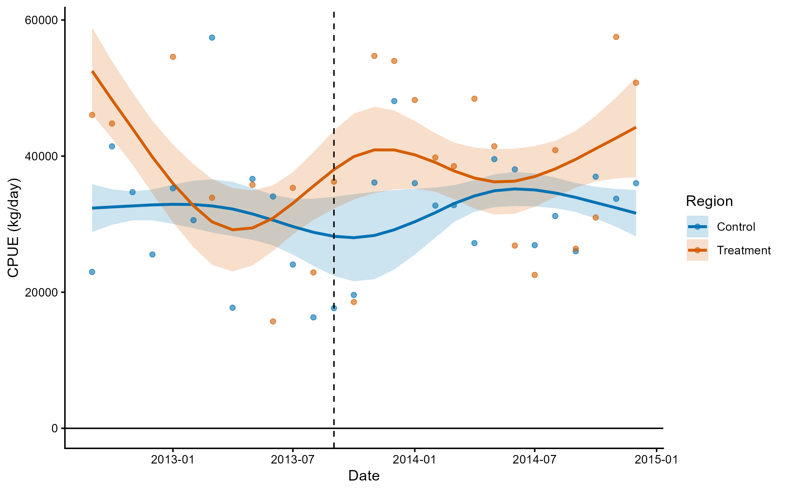{width=70%}

- $\beta$ = 0.192, SE = 0.192, *p* \< 0.1
:::

::: {.column width="30%"}

:::fragment

- **Environmental hypothesis:** CPUE *should* $\uparrow$

- **Blue paradox hypothesis:** CPUE *should* remain stable or even $\downarrow$ over time

:::

:::
:::

:::{.notes}
- Now that we've established that RFMO data can reproduce the broad fishing-effort patterns , we can turn to our second question: what does the addition of CPUE reveal?
- Looking at the time series, the picture is not particularly clear. We see a slight increase in catch per unit effort following the announcement of PIPA, but this increase eventually levels off, with values becoming comparable to those observed in the control region.
- Our model tells a similar story and estimates a small positive treatment effect on CPUE, but this effect is not statistically significant.
- If you recall our two competing explanations,  If CPUE had increased substantially, that would have been more consistent with the environmental hypothesis: that changing environmental conditions increased tuna availability in the MPA, attracting more fishing activity.
- **While we do observe a slight positive change in CPUE, the effect is not strong enough to provide convincing evidence for this explanation.**
- But equally, we don't find clear evidence that CPUE remained constant or declined, as we might expect under the preemptive fishing explanation.
- **Ultimately, adding CPUE gives us another piece of the puzzle, but it doesn't allow us to conclusively distinguish between the two explanations.** We therefore cannot confidently attribute the increase in fishing effort to preemptive fishing or environmental changes ahead of the closure.

:::

## Implications for Equitable MPA Design

:::::{.columns}

:::{.column width= "50%"}
::: fragment
**What did we learn from PIPA?**
:::

- RFMO data can reproduce broad fishing-effort patterns.
- Increased effort does not necessarily indicate preemptive fishing.

::: fragment
**What does this mean for MPA design?**
:::

- Ecological conditions may explain fishing responses.
- Better data are needed to distinguish these explanations.


:::

:::{.column width= "50%"}


:::
:::::

::: fragment
**Understanding why fishing activity changes before an MPA can help inform more equitable conservation planning**
:::

:::{.notes}

- So, stepping back, what did we learn from the PIPA case study?
- First, publicly available RFMO data can reproduce broad fishing-effort patterns observed in vessel tracking-based analysis, offering another useful data source not only for evaluating fishing activity around MPA announcements, but other ecological and social studies.
- **Second, and perhaps more importantly, our findings suggest that an increased in fishing effort does not necessarily mean fishers are rushing to exploit an area before it closes.** In PIPA, ecological conditions may also have played a role, although our data weren't sufficient to distinguish between these explanations.
- This brings us to the broader implications for MPA design. If we misinterpret changes in fishing activity as preemptive behavior, we risk overlooking the ecological conditions influencing where fishers operate.
- Perhaps if this study had a finer resolution of RFMO data available, we would have been able to see more clearly the changes in catch per unit effort
- Ultimately, understanding *why* fishing activity changes before an MPA is implemented can help us better anticipate its effects on fishing communities and inform more equitable conservation planning.

With that, I'd like to thank my committee members for their time and contributions to this work, and thank you all for your time and attention. Are there any questions?

:::

# Questions?

## References
::: {#refs}
:::

::: {.nonincremental}

# Appendix

## Data Preparation

1. **Source:** IATTC and WCPFC monthly catch and effort data (@iattcPublicDomainData, @WCPFCPublicDomain).
2. **Select:** Grid cells inside or intersecting PIPA and the control EEZs.
3. **Aggregate:** Sum catch, fishing days, and sets by region and month.
   - Before: pre-announcement
   - After: anticipation period
4. **Standardize:** Express effort and catch per 10,000 km²; calculate CPUE (total catch / total effort).

### Final estimation panel

- **52 region-month observations**
- 28 control cells · 24 treated cells

## Separating MPA effects from environmental change

<!--::: fragment
**Core question**: Did fishing behavior change inside PIPA after its announcement, beyond changes also occurring in comparable control areas?
:::-->


::::: columns
::: {.column width="50%"}
> **Impact: PIPA** Area within or intersecting the MPA boundary

:::
::: {.column width="50%"}
> **Control: Line + Gilbert Islands** Comparable areas outside PIPA

:::
:::::


**Difference-in-differences model**
$$\text{log}(Y_{it}) = \beta_0 + \beta_1\text{Treatment}_i + \beta_2\text{Post}_t + \beta_3(\text{Treatment}_i \times \text{Post}_t) + \epsilon_{it}$$


**Key estimate:** $\beta_3$

- The additional change in PIPA relative to the change in control areas (our estimate of the blue paradox in PIPA)


## CPUE hypothesis

$$CPUE = \frac{C}{E} = qN$$

$q$ = catchability; $N$ = biomass; $E$ = effort.

| | Blue Paradox | ENSO |
|---|---:|---:|
| Biomass ($N$)| 100 → 100 | 100 → 150 |
| Effort ($E$) | 10 → 20 | 10 → 20 |
| Catchability ($q$) | 0.01 | 0.01 |
| **CPUE** | **1 → 1** | **1 → 1.5** |

- **Blue Paradox:** More effort alone does not increase CPUE.
- **ENSO:** More abundance should increase CPUE.

*Illustrative values; assuming constant catchability.*

# Global Fishing Watch data comparison

## Fishing days

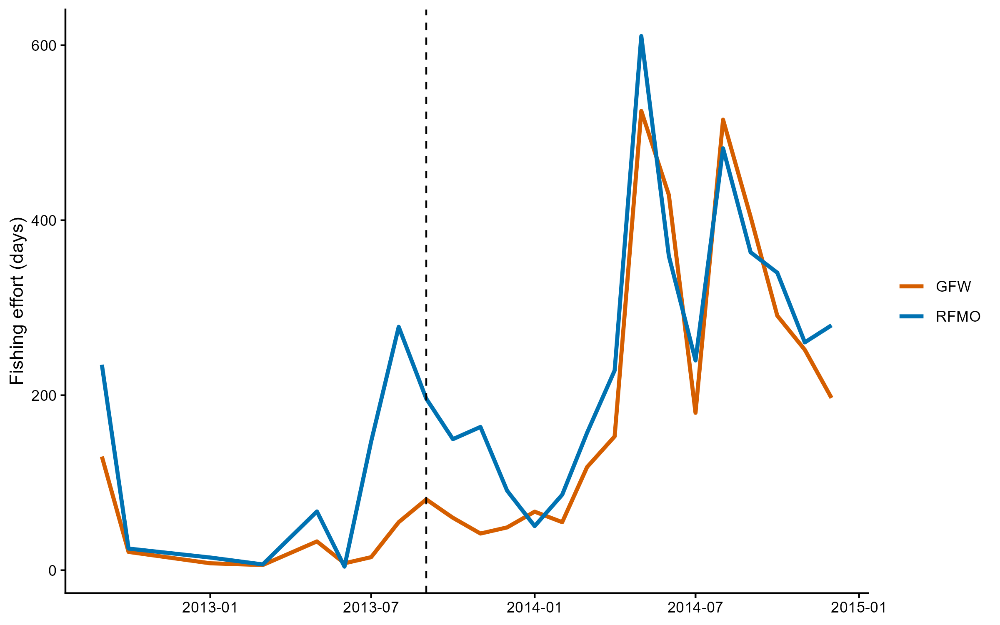{#fig-pipa-gfw-rfmo-days}

## RFMO fishing days vs GFW fishing hours
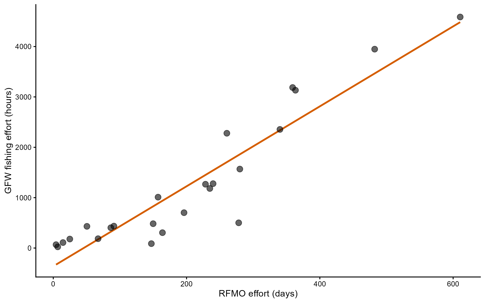{#fig-pipa-gfw-rfmo-days-hours fig-pos="H"}

## Phoenix Island Protected Area full results

{#fig-pipa-region}

# Additional Case Studies

# Galápagos Marine Reserve

## Map

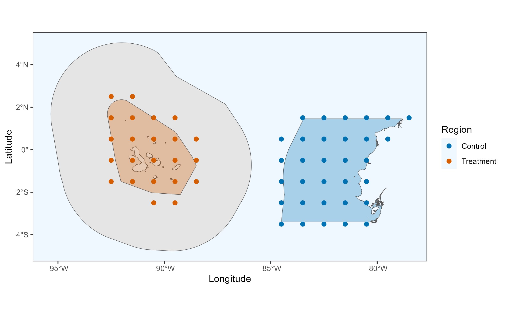{#fig-gmr-map}

## Results

{#fig-gmr-region}

# Revillagigedo National Park

## Map

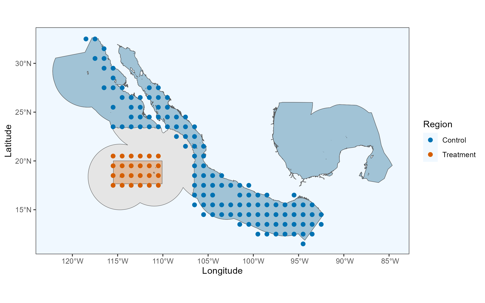{#fig-revilla-map}

## Results

{#fig-revilla-region}

# Palau National Marine Sanctuary

## Map

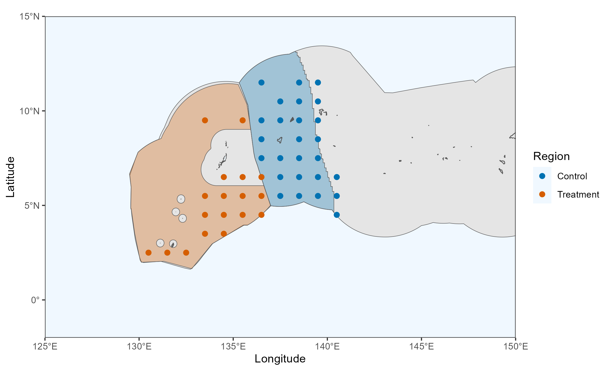{#fig-palau-map}

## Results

{#fig-palau-region}


